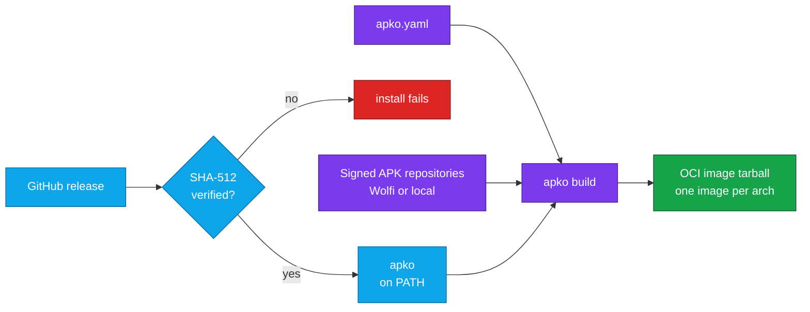

<div align="center">


# apko Orb for CircleCI

### Build minimal, distroless, multi-arch container images without a Dockerfile, a Docker daemon or emulation.

Install [apko](https://github.com/chainguard-dev/apko) and assemble OCI images straight from the APK packages listed in a YAML file<br>
with two steps of CircleCI config.<br>
Strict SHA-512 verification by default · No `sudo` · No usage data collected by the orb

[](https://circleci.com/gh/juburr/apko-orb)
[](https://circleci.com/developer/orbs/orb/juburr/apko-orb)
[](LICENSE)
[](https://discuss.circleci.com/c/ecosystem/orbs)


**[Quick Start](#-quick-start)** · **[Features](#-why-apko-orb)** · **[Multi-Arch](#-multi-architecture-images)** · **[Local APKs](#-installing-packages-from-a-local-signed-repository)** · **[Commands](#-commands)** · **[Security](#-secure-by-design)**

<sub>An unofficial, community-maintained orb. [Contributions are welcome!](#-contributing)</sub>

</div>

<br>

## ✨ Why apko-orb?

<table>
<tr>
<td width="33%" valign="top">
🪶 <b>Only what you list</b><br><br>
apko assembles the image from the APK packages in your YAML file, so it holds the packages you list and what they depend on, and nothing else. No Dockerfile and no <code>RUN</code> steps to maintain.
</td>
<td width="33%" valign="top">
🐳 <b>No Docker daemon to build</b><br><br>
<code>apko/build</code> writes an OCI image tarball directly. You only need Docker if you want to load or run the image afterwards.
</td>
<td width="33%" valign="top">
🐙 <b>Multi-arch, no emulation</b><br><br>
Build <code>amd64</code> and <code>arm64</code> images from one executor. No QEMU, no buildx. See <a href="#-multi-architecture-images">Multi-Architecture Images</a>.
</td>
</tr>
<tr>
<td width="33%" valign="top">
📦 <b>Bring your own APKs</b><br><br>
Install the packages you build with melange from a local repository signed with an ephemeral key, alongside public Wolfi packages. See <a href="#-installing-packages-from-a-local-signed-repository">Local Signed Repositories</a>.
</td>
<td width="33%" valign="top">
🔐 <b>Verified installs, fail-closed by default</b><br><br>
By default, every apko binary is checked against a SHA-512 table built into the orb, and versions it can't verify are refused, not run. <a href="#-checksum-verification">Opt-outs</a> are explicit.
</td>
<td width="33%" valign="top">
🦾 <b>amd64 and arm64 executors</b><br><br>
Picks the right apko build for x86_64 executors and CircleCI Arm resource classes, cached per version and architecture so repeat runs skip the download.
</td>
</tr>
</table>

### 🧩 The Orb vs. a Hand-Rolled Script

| | Scripting apko yourself | With the orb |
| --- | --- | --- |
| **Getting the right build** | Map `uname -m` to apko's `linux_amd64` or `linux_arm64` tarball, extract the binary and put it on the `PATH` | `apko/install` picks it for the executor's CPU and adds `install_path` to the `PATH` of later steps when it isn't already there |
| **Verifying it** | Download apko's `checksums.txt` and compare hashes yourself | Checked against a SHA-512 table built into the orb; by default, a version with no entry is refused before anything is downloaded |
| **Caching** | Write cache keys that never mix versions or CPU architectures | Cached per version, CPU architecture and home directory, and verified again whenever it is restored |
| **A broken download** | A binary that can't run can replace a working one | The new binary has to run `apko version` before it replaces anything |

## 🔄 How It Works



`apko/install` downloads apko straight from its official GitHub releases, verifies its SHA-512 checksum in the default `strict` mode shown here, and puts it on `PATH`. See [Checksum Verification](#-checksum-verification) for the other modes. `apko/build` reads your image configuration, installs the packages it lists from repositories whose indexes are signed by a key in its keyring (Wolfi, your own melange-built repository, or both), and writes an OCI image tarball with one image per architecture. Nothing is pushed: load it with `docker load`, scan it, publish it, or keep it with `store_artifacts`.

## 🚀 Quick Start

**1. Describe your image** in `apko.yaml`:

```yaml
contents:
  keyring:
    - https://packages.wolfi.dev/os/wolfi-signing.rsa.pub
  repositories:
    - https://packages.wolfi.dev/os
  packages:
    - ca-certificates-bundle
    - busybox

accounts:
  groups:
    - groupname: nonroot
      gid: 65532
  users:
    - username: nonroot
      uid: 65532
  run-as: nonroot

archs:
  - amd64
  - arm64
```

**2. Add the orb** to `.circleci/config.yml`:

```yaml
version: 2.1

orbs:
  apko: juburr/apko-orb@0.5.0

jobs:
  build-image:
    docker:
      - image: cimg/base:current-22.04
    steps:
      - checkout
      - apko/install
      - apko/build:
          config: apko.yaml
          image: ghcr.io/my-org/my-app:latest
          output_path: build/my-app.tar
      - setup_remote_docker
      - run:
          name: Smoke Test Image
          command: |
            docker load --input build/my-app.tar
            docker run --rm ghcr.io/my-org/my-app:latest-amd64 busybox echo "hello from apko"

workflows:
  build:
    jobs:
      - build-image
```

**3. Push.** The job writes `build/my-app.tar`, an OCI image tarball with one image per architecture, then loads it into Docker and runs the `amd64` image. Swap in your own packages and image name. From there, scan the image, publish it, or keep it with `store_artifacts`.

> [!TIP]
> Upgrading from 0.4.0 or earlier? `build`'s `config_path` and `image_uri` parameters are now `config` and `image`, and `install` refuses apko versions it has no checksum for. See [Upgrading](#-upgrading).

> [!TIP]
> String parameters are passed through `circleci env subst`, so they can use environment variables. For example, `image: ghcr.io/my-org/my-app:${CIRCLE_SHA1}` tags each image with its commit.

> [!NOTE]
> `build` never pushes to a registry, and `docker load` tags each architecture's image with an architecture suffix, such as `ghcr.io/my-org/my-app:latest-amd64`, even when you build only one architecture.

## 🐙 Multi-Architecture Images

apko assembles images without running code for the target architecture, so a single executor can build `amd64` and `arm64` images without emulation. List the architectures under `archs` in the apko configuration, or override that list with the `build` command's `arch` parameter (for example `arch: amd64,arm64`, or `arch: host` to build only for the executor's architecture).

- The output tarball contains an OCI image index. `docker load` loads one image per architecture, tagged with an architecture suffix such as `my-image:latest-amd64` and `my-image:latest-arm64`. Single-architecture builds are suffixed too.
- It works in both directions: CI builds an `amd64,arm64` image on an amd64 Docker executor, and an `amd64` image on an arm64 machine executor.
- Running an `arm64` image, for example in a smoke test, still requires an `arm64` executor or emulation.

## 🔏 Installing Packages From A Local Signed Repository

The `build` command can install your own melange-built APKs from a build-local repository signed with an ephemeral key (`melange keygen`). List the repository and public key in the apko configuration as paths relative to the job's working directory, and pin local packages with a repository tag:

```yaml
contents:
  keyring:
    - https://packages.wolfi.dev/os/wolfi-signing.rsa.pub
    - ./melange.rsa.pub
  repositories:
    - https://packages.wolfi.dev/os
    - '@local ./packages'
  packages:
    - my-app@local
```

- apko refuses a repository index that is not signed by a key in the keyring, so the ephemeral public key must be listed.
- Without the `@local` pin, apko installs the highest version available in any repository, so a same-named public package could replace yours.
- Every architecture in `archs` needs a matching directory in the local repository (for example `packages/x86_64` and `packages/aarch64`).
- melange's `docker` runner needs a local Docker daemon, so build the packages on a machine executor.

The companion [melange orb](https://github.com/juburr/melange-orb) installs melange with the same checksum verification, and its [Building Packages](https://github.com/juburr/melange-orb#-building-packages) section covers runners and where the signed packages land. See the [`local_signed_repository`](src/examples/local_signed_repository.yml) usage example for a complete job that uses both orbs.

## 🧰 Commands

### `apko/install`

Installs apko for Linux on amd64 or arm64, matching the executor's CPU. In the default `strict` mode it verifies the SHA-512 checksum first and refuses versions it has no checksum for; see [Checksum Verification](#-checksum-verification) for the opt-outs. Run it before `apko/build`. Needs bash 4 or newer on the executor.

| Parameter | Default | Description |
| --- | --- | --- |
| `version` | `1.4.6` | apko release to install; a leading `v` is ignored. Pin it so apko only changes when you decide to. Values that aren't a release version, such as `latest`, are rejected. |
| `install_path` | `$HOME/bin` | Absolute path of the directory to install into, writable without root. Created if needed, and added to `PATH` for later steps when it isn't already on it. A leading `~/` is expanded. |
| `verify_checksums` | `strict` | `strict`, `known_versions` or `false`. See [Checksum Verification](#-checksum-verification). |
| `caching` | `true` | Cache the verified release between jobs, keyed by version, CPU architecture and home directory. Only verified releases are cached, and a cached release is verified again before it is installed. |

### `apko/build`

Builds an image with `apko build` and writes it to `output_path`. The image is not pushed to a registry, and building needs no Docker daemon. Run `apko/install` first. A missing `config` fails the step with `ERROR: Configuration YAML does not exist at: <config>`.

| Parameter | Default | Description |
| --- | --- | --- |
| `config` | *required* | Path to the apko image configuration YAML file, e.g. `apko.yaml`. |
| `image` | *required* | Image reference recorded in the output (apko's `<tag>` argument), e.g. `ghcr.io/my-org/my-app:latest`. The image is not pushed. `docker load` tags each architecture's image with this reference plus an architecture suffix, e.g. `ghcr.io/my-org/my-app:latest-amd64`. |
| `output_path` | *required* | Path of the OCI image tarball to write, e.g. `build/my-app.tar`. Missing parent directories are created. If the path is an existing directory, apko writes an OCI image layout into it instead. |
| `arch` | *(empty)* | Comma-separated architectures passed to apko's `--arch`, e.g. `amd64,arm64` or `host`. Overrides `archs` in the configuration file; leave it empty to use the file's list. |
| `log_level` | `debug` | apko's `--log-level`: `debug`, `info`, `warn`, `error`, `fatal` or `panic`. |

Environment variables are expanded in `install`'s `version` and `install_path`, and in `build`'s `config`, `image`, `output_path` and `arch`. `log_level` is an enum, so CircleCI checks its value before any step runs and it can't take a variable.

## 📦 Upgrading

Releases after 0.4.0 rename two `build` parameters. The values they take and the build itself are unchanged.

| Old (0.4.0 and earlier) | New |
| --- | --- |
| `config_path` | `config` |
| `image_uri` | `image` |

Behavior changes:
- When `config` does not exist, `build` now prints `ERROR: Configuration YAML does not exist at: <config>` to stderr. Before, the message had no `ERROR:` prefix and went to stdout.
- `install` defaults to `verify_checksums: strict` instead of `known_versions`, so an apko version with no checksum in the orb's table fails the install. See [Checksum Verification](#-checksum-verification).
- `install_path` defaults to `$HOME/bin` instead of `/home/circleci/bin`, the same directory on CircleCI's images. It must be an absolute path without a `:`, and it is created and added to the `PATH` of later steps when needed.
- `version` must be a release version, such as `1.4.6`. Anything else is rejected before anything is downloaded.
- `install` needs bash 4 or newer, and fails when the downloaded binary can't run on the executor.
- The cache key and location changed, so the first run after upgrading downloads apko again.

## 🔒 Secure by Design

- **Least Privilege**: Installs to a user-owned directory by default, with no `sudo` usage anywhere in this orb.
- **Integrity**: SHA-512 checksum validation of downloaded binaries, on by default and failing closed: an apko version this orb has no checksum for is refused, not installed unverified, and a binary that can't run on the executor never replaces an existing install. See [Checksum Verification](#-checksum-verification) for the `known_versions` and `false` opt-outs.
- **Provenance**: Installs directly from apko's official [releases page](https://github.com/chainguard-dev/apko/releases/) on GitHub. No third-party websites, domains, or proxies are used.
- **Confidentiality**: All secrets and environment variables are handled in accordance with CircleCI's [security recommendations](https://circleci.com/docs/security-recommendations/) and [best practices](https://circleci.com/docs/orbs-best-practices/).
- **Privacy**: No usage data of any kind is collected or shipped back to the orb developer.

> [!IMPORTANT]
> **Info for security teams:** see [Network Access](#-network-access) for the hosts to allow on locked-down or self-hosted runners.

## 💻 Supported Platforms

Linux executors on `x86_64` (amd64) and `aarch64`/`arm64` (arm64), including CircleCI [Arm resource classes](https://circleci.com/docs/using-arm/). The `install` command picks the apko release asset for the architecture reported by `uname -m` and, in the default `strict` mode, verifies it against that architecture's SHA-512 checksum. Any other operating system or architecture fails the install rather than installing a binary that can't run.

| `uname -m` | Release asset installed |
| --- | --- |
| `x86_64` or `amd64` | `apko_<version>_linux_amd64.tar.gz` |
| `aarch64` or `arm64` | `apko_<version>_linux_arm64.tar.gz` |

`install` needs bash 4 or newer, `mktemp`, `tar`, `gzip`, and `curl` or `wget`, plus `sha512sum` when it verifies. CI runs both commands on the Docker executor (`cimg/base`) and on amd64 and arm64 machine executors (`ubuntu-2404:current`).

The download cache is keyed by apko version, executor architecture and home directory, so amd64 and arm64 jobs never share a cached binary. On executors whose `PATH` doesn't already include `install_path` (for example, machine executors), `install` adds it for later steps through `BASH_ENV`.

## 🔐 Checksum Verification

The `install` command checks the downloaded apko binary against a SHA-512 lookup table built into the orb, with one entry per apko version and architecture. The `verify_checksums` parameter controls what happens:

| Value | Version in the orb's table | Version not in the table |
| --- | --- | --- |
| `strict` (default) | ✅ Verified; install fails on mismatch | ⛔ Install fails before anything is downloaded |
| `known_versions` | ✅ Verified; install fails on mismatch | ⚠️ Installed **unverified**, with a warning |
| `false` | ⚠️ Not verified | ⚠️ Installed **unverified** |

The table covers apko releases from 0.1 up to the default `version`, 1.4.6, on both architectures. If you pin an apko release newer than this orb, `strict` fails until the orb is upgraded. Upgrade the orb (or open a PR adding the checksum, generated with `src/scripts/install_hash.sh`) rather than opting out. `known_versions` and `false` remain available for cases where you accept running an unverified binary.

> [!WARNING]
> **Changed in the next release:** the default was previously `known_versions`, which installed unlisted versions without verification. Pipelines that pin an apko version newer than the orb's table now fail until they upgrade the orb or set `verify_checksums: known_versions` explicitly.

## 🌐 Network Access

Hosts to allow (HTTPS, port 443) when running on a locked-down or self-hosted runner:

| Host | Needed by | Purpose |
| --- | --- | --- |
| `github.com` | `install` | apko release download |
| `release-assets.githubusercontent.com` | `install` | Where GitHub redirects release downloads |
| `objects.githubusercontent.com` | `install` | GitHub's previous redirect target for release downloads; allow it as well so a change on GitHub's side doesn't break downloads |
| `packages.wolfi.dev` | `build` with Wolfi-based configurations | apko fetches the signing key, the `APKINDEX.tar.gz` index and the packages, and requests `/os/apk-configuration` for key discovery |
| Any other repository or keyring URL in your configuration | `build` | Depends on your apko configuration. Local repository and key paths need no network access. |

## 🤝 Contributing

This is an unofficial, community-maintained orb, and contributions are welcome! Bug reports, feature ideas and pull requests all help.

- **Found a bug or have an idea?** [Open an issue](https://github.com/juburr/apko-orb/issues).
- **Need a newer apko release?** Generate its checksums with `src/scripts/install_hash.sh -v <version>`, paste them into the `sha512sums` table in [`src/scripts/install.sh`](src/scripts/install.sh), and open a pull request. The script checks each asset against the SHA-256 checksums apko publishes with the release (`checksums.txt`) and needs bash 4 or newer, `mktemp`, `curl`, `sha256sum`, `sha512sum`, `tar` and `gzip`. For a release with nothing published to check against, `-c` takes a checksum from another official source (a SHA-1 one also needs `sha1sum`), or `NONE`; it never overrides what the release did publish.
- **Before opening a pull request**, run `yamllint .`, `shellcheck src/scripts/*.sh`, `bash src/tests/install_test.sh`, `bash src/tests/env-subst.sh` and `bash src/tests/shell_conventions_test.sh`. They run offline; CI runs them too, along with the orb linter and the build tests on amd64 and arm64.

## 🎨 Logo

Need the logo for a slide deck, blog post, or internal developer portal? PNGs with transparent backgrounds are in [`assets/logos`](assets/logos): [64](assets/logos/apko-orb-64px.png) · [128](assets/logos/apko-orb-128px.png) · [256](assets/logos/apko-orb-256px.png) · [512](assets/logos/apko-orb-512px.png) · [1024](assets/logos/apko-orb-1024px.png) px

## 📜 License

[MIT](LICENSE) © 2024-2025 Justin Burr

<br>

<div align="center">
  
  <br>
  <sub>Distroless images from a YAML file. If this orb helps your team, a ⭐ helps others find it.</sub>
  <br>
  <sub><a href="#apko-orb-for-circleci">Back to top ↑</a></sub>
</div>
