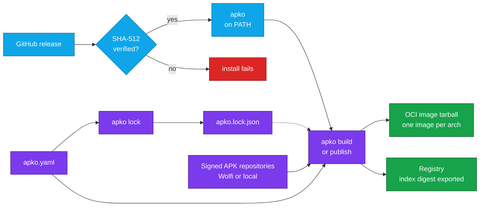

<div align="center">


# apko for CircleCI and GitHub Actions

### Build minimal, distroless, multi-arch container images without a Dockerfile, a Docker daemon or emulation.

Install [apko](https://github.com/chainguard-dev/apko) and assemble OCI images straight from the APK packages listed in a YAML file<br>
with two steps of CircleCI config, or two GitHub Actions, then lock their packages and push them to a registry.<br>
Strict SHA-512 verification by default · No `sudo` · No usage data collected by the orb

[](https://circleci.com/gh/juburr/apko-orb)
[](https://github.com/juburr/apko-orb/actions/workflows/actions.yml)
[](https://circleci.com/developer/orbs/orb/juburr/apko-orb)
[](LICENSE)
[](https://discuss.circleci.com/c/ecosystem/orbs)


**[Quick Start](#-quick-start)** · **[Features](#-why-apko-orb)** · **[Multi-Arch](#-multi-architecture-images)** · **[Publishing](#-publishing-images)** · **[Lock Files](#-locking-package-versions)** · **[Local APKs](#-installing-packages-from-a-local-signed-repository)** · **[CircleCI Commands](#-circleci-commands)** · **[GitHub Actions](#-github-actions)** · **[Security](#-secure-by-design)**

<sub>An unofficial, community-maintained CircleCI orb and set of GitHub Actions. [Contributions are welcome!](#-contributing)</sub>

</div>

<br>

## ✨ Why apko-orb?

<table>
<tr>
<td width="33%" valign="top">
🪶 <b>Only what you list</b><br><br>
apko assembles the image from the APK packages in your YAML file, so it holds the packages you list and what they depend on, and nothing else. No Dockerfile and no <code>RUN</code> steps to maintain.
</td>
<td width="33%" valign="top">
🐳 <b>No Docker daemon to build</b><br><br>
<code>apko/build</code> writes an OCI image tarball and <code>apko/publish</code> pushes to a registry, both without Docker. You only need Docker if you want to load or run the image.
</td>
<td width="33%" valign="top">
🐙 <b>Multi-arch, no emulation</b><br><br>
Build <code>amd64</code> and <code>arm64</code> images from one executor. No QEMU, no buildx. See <a href="#-multi-architecture-images">Multi-Architecture Images</a>.
</td>
</tr>
<tr>
<td width="33%" valign="top">
📦 <b>Bring your own APKs</b><br><br>
Install the packages you build with melange from a local repository signed with an ephemeral key, alongside public Wolfi packages. See <a href="#-installing-packages-from-a-local-signed-repository">Local Signed Repositories</a>.
</td>
<td width="33%" valign="top">
🔐 <b>Verified installs, fail-closed by default</b><br><br>
By default, every apko binary is checked against a SHA-512 table built into the orb, and versions it can't verify are refused, not run. <a href="#-checksum-verification">Opt-outs</a> are explicit.
</td>
<td width="33%" valign="top">
🦾 <b>amd64 and arm64 executors</b><br><br>
Picks the right apko build for x86_64 executors, CircleCI Arm resource classes and GitHub's arm64 runners, cached per version and architecture so repeat runs skip the download.
</td>
</tr>
<tr>
<td width="33%" valign="top">
📤 <b>Push straight to a registry</b><br><br>
<code>apko/publish</code> pushes every architecture's image and the image index in one step, then exports the index's digest, ready for signing. See <a href="#-publishing-images">Publishing Images</a>.
</td>
<td width="33%" valign="top">
📌 <b>Locked package versions</b><br><br>
<code>apko/lock</code> pins every package to an exact version and checksum. Build from the lock file, and the image only changes when you commit a new one. See <a href="#-locking-package-versions">Locking Package Versions</a>.
</td>
<td width="33%" valign="top">
🧾 <b>SBOMs included</b><br><br>
apko writes an SPDX SBOM for each architecture and one for the index. <code>sbom_path</code> puts them where your pipeline stores or scans them.
</td>
</tr>
</table>

### 🧩 The Orb vs. a Hand-Rolled Script

| | Scripting apko yourself | With the orb |
| --- | --- | --- |
| **Getting the right build** | Map `uname -m` to apko's `linux_amd64` or `linux_arm64` tarball, extract the binary and put it on the `PATH` | `apko/install` picks it for the executor's CPU and adds `install_path` to the `PATH` of later steps when it isn't already there |
| **Verifying it** | Download apko's `checksums.txt` and compare hashes yourself | Checked against a SHA-512 table built into the orb; by default, a version with no entry is refused before anything is downloaded |
| **Caching** | Write cache keys that never mix versions or CPU architectures | Cached per version, CPU architecture and home directory, and verified again whenever it is restored |
| **A broken download** | A binary that can't run can replace a working one | The new binary has to run `apko version` before it replaces anything |

## 🔄 How It Works



`apko/install` downloads apko straight from its official GitHub releases, verifies its SHA-512 checksum in the default `strict` mode shown here, and puts it on `PATH`. See [Checksum Verification](#-checksum-verification) for the other modes. `apko/build` reads your image configuration, installs the packages it lists from repositories whose indexes are signed by a key in its keyring (Wolfi, your own melange-built repository, or both), and writes an OCI image tarball with one image per architecture. Nothing is pushed: load it with `docker load`, scan it, or keep it with `store_artifacts`. `apko/publish` builds the same way, pushes the images and their index to a registry instead, and exports the index's digest. `apko/lock` pins every package to an exact version, in a lock file both of them take as `lockfile`.

## 🚀 Quick Start

**1. Describe your image** in `apko.yaml`:

```yaml
contents:
  keyring:
    - https://packages.wolfi.dev/os/wolfi-signing.rsa.pub
  repositories:
    - https://packages.wolfi.dev/os
  packages:
    - ca-certificates-bundle
    - busybox

accounts:
  groups:
    - groupname: nonroot
      gid: 65532
  users:
    - username: nonroot
      uid: 65532
  run-as: nonroot

archs:
  - amd64
  - arm64
```

**2. Add the steps to your pipeline.** On CircleCI, add the orb to `.circleci/config.yml`:

```yaml
version: 2.1

orbs:
  apko: juburr/apko-orb@1.2.1

jobs:
  build-image:
    docker:
      - image: cimg/base:current-22.04
    steps:
      - checkout
      - apko/install
      - apko/build:
          config: apko.yaml
          image: ghcr.io/my-org/my-app:latest
          output_path: build/my-app.tar
      - setup_remote_docker
      - run:
          name: Smoke Test Image
          command: |
            docker load --input build/my-app.tar
            docker run --rm ghcr.io/my-org/my-app:latest-amd64 busybox echo "hello from apko"

workflows:
  build:
    jobs:
      - build-image
```

On GitHub Actions, use the `install` and `build` actions in a workflow, such as `.github/workflows/build.yml`:

```yaml
name: Build image

on: push

jobs:
  build-image:
    runs-on: ubuntu-24.04
    steps:
      - uses: actions/checkout@v7
      - uses: juburr/apko-orb/actions/install@v1.2.1
      - uses: juburr/apko-orb/actions/build@v1.2.1
        with:
          config: apko.yaml
          image: ghcr.io/my-org/my-app:latest
          output_path: build/my-app.tar
      - name: Smoke test image
        run: |
          docker load --input build/my-app.tar
          docker run --rm ghcr.io/my-org/my-app:latest-amd64 busybox echo "hello from apko"
```

See [GitHub Actions](#-github-actions) for how the actions map to the orb's commands.

**3. Push.** The job writes `build/my-app.tar`, an OCI image tarball with one image per architecture, then loads it into Docker and runs the `amd64` image. Swap in your own packages and image name. From there, scan the image, keep it with `store_artifacts` (or `actions/upload-artifact`), or [publish it](#-publishing-images) to a registry.

> [!TIP]
> Upgrading from 0.4.0 or earlier? `build`'s `config_path` and `image_uri` parameters are now `config` and `image`, and `install` refuses apko versions it has no checksum for. See [Upgrading](#-upgrading).

> [!TIP]
> On CircleCI, string parameters are passed through `circleci env subst`, so they can use environment variables. For example, `image: ghcr.io/my-org/my-app:${CIRCLE_SHA1}` tags each image with its commit. On GitHub Actions, use an expression instead: `image: ghcr.io/my-org/my-app:${{ github.sha }}`.

> [!NOTE]
> `build` never pushes to a registry (`publish` does), and `docker load` tags each architecture's image with an architecture suffix, such as `ghcr.io/my-org/my-app:latest-amd64`, even when you build only one architecture.

## 🐙 Multi-Architecture Images

apko assembles images without running code for the target architecture, so a single executor can build `amd64` and `arm64` images without emulation. List the architectures under `archs` in the apko configuration, or override that list with the `build` command's `arch` parameter (for example `arch: amd64,arm64`, or `arch: host` to build only for the executor's architecture).

- The output tarball contains an OCI image index. `docker load` loads one image per architecture, tagged with an architecture suffix such as `my-image:latest-amd64` and `my-image:latest-arm64`. Single-architecture builds are suffixed too.
- It works in both directions: CI builds an `amd64,arm64` image on an amd64 Docker executor, and an `amd64` image on an arm64 machine executor.
- Running an `arm64` image, for example in a smoke test, still requires an `arm64` executor or emulation.

## 📤 Publishing Images

`apko/publish` builds the image and pushes it in one step: each architecture's image to the repository of the first reference in `tags`, by digest, then the image index under every reference. It takes the same image options as `build`, and exports the index's digest (`APKO_DIGEST`) and its reference by digest (`APKO_DIGEST_REF`), so later steps sign or deploy exactly what was pushed.

apko reads registry credentials where Docker stores them, in `~/.docker/config.json`. `apko/login` stores them there from two environment variables, handing apko the password on stdin; `docker login` works too.

```yaml
version: 2.1

orbs:
  apko: juburr/apko-orb@1.2.1
  cosign: juburr/cosign-orb@1.1.0

jobs:
  publish-image:
    docker:
      - image: cimg/base:current-22.04
    steps:
      - checkout
      - apko/install
      - apko/login:
          registry: ghcr.io
          username: GHCR_USERNAME
          password: GHCR_TOKEN
      - apko/publish:
          config: apko.yaml
          tags: ghcr.io/my-org/my-app:${CIRCLE_SHA1} ghcr.io/my-org/my-app:latest
          sbom_path: sboms
      # cosign signs the index by digest, with the credentials login stored.
      - cosign/install
      - cosign/sign:
          image: ${APKO_DIGEST_REF}
      - store_artifacts:
          path: sboms

workflows:
  publish:
    jobs:
      - publish-image:
          context: image-publishing
```

On GitHub Actions, apko also reads `GITHUB_TOKEN` for `ghcr.io`, so a job with `packages: write` needs no login step:

```yaml
jobs:
  publish-image:
    runs-on: ubuntu-24.04
    permissions:
      contents: read
      packages: write
    steps:
      - uses: actions/checkout@v7
      - uses: juburr/apko-orb/actions/install@v1.2.1
      - uses: juburr/apko-orb/actions/publish@v1.2.1
        env:
          GITHUB_TOKEN: ${{ github.token }}
        with:
          config: apko.yaml
          tags: ghcr.io/my-org/my-app:${{ github.sha }} ghcr.io/my-org/my-app:latest
      - run: echo "Pushed ${APKO_DIGEST_REF}"
```

For another registry, use the `login` action first, with the secrets in its step's `env`. `image_refs` writes every pushed reference to a file, one per line: each architecture's image by digest, then the index. See the [`publish`](src/examples/publish.yml) usage example.

## 📌 Locking Package Versions

Without a lock file, every build installs the newest versions the repositories offer, so the same `apko.yaml` can give a different image tomorrow. `apko/lock` resolves every package, for every architecture, to an exact version and checksum, and writes them, with the repositories and keys, to a lock file: `apko.lock.json` for `apko.yaml`. Commit it, and pass it to `build` or `publish`:

```yaml
      - apko/build:
          config: apko.yaml
          lockfile: apko.lock.json
          image: ghcr.io/my-org/my-app:latest
          output_path: build/my-app.tar
```

apko then installs exactly the locked packages, and the image only changes when the lock file does. A scheduled job that runs `apko/lock` and opens a pull request with the result turns package updates into reviewable diffs; the [`lock_file`](src/examples/lock_file.yml) usage example has one that stores the new lock file for review.

- Lock every architecture you build. A lock file made with `arch: amd64` can't build `arm64`.
- apko still marks `lock` as a hidden command while it gathers feedback on it. `build`'s and `publish`'s `--lockfile` read the file it writes.
- With `cache_dir`, apko keeps the indexes, keys and packages it downloads in that directory. Keep it with `save_cache`, or pass it on through a workspace, and a later `build` with `offline: true` needs no network at all. CI locks a test image, builds it into a cache, then builds it again offline from the cache and checks that it holds the locked versions.

## 🔏 Installing Packages From A Local Signed Repository

The `build` command can install your own melange-built APKs from a build-local repository signed with an ephemeral key, such as the one melange-orb's `keygen` command writes. List the repository and public key in the apko configuration as paths relative to the job's working directory, and pin local packages with a repository tag:

```yaml
contents:
  keyring:
    - https://packages.wolfi.dev/os/wolfi-signing.rsa.pub
    - ./melange.rsa.pub
  repositories:
    - https://packages.wolfi.dev/os
    - '@local ./packages'
  packages:
    - my-app@local
```

- apko refuses a repository index that is not signed by a key in the keyring, so the ephemeral public key must be listed.
- Without the `@local` pin, apko installs the highest version available in any repository, so a same-named public package could replace yours.
- Every architecture in `archs` needs a matching directory in the local repository (for example `packages/x86_64` and `packages/aarch64`).
- melange's `docker` runner needs a local Docker daemon, so build the packages on a machine executor.

The companion [melange orb](https://github.com/juburr/melange-orb) installs melange with the same checksum verification and builds the packages: its `keygen` command writes `melange.rsa` and `melange.rsa.pub`, and its `build` command signs with `melange.rsa` and writes the packages to `packages/<arch>/` with a signed index, the names the configuration above uses. Its [Building Packages](https://github.com/juburr/melange-orb#-building-packages) section covers runners and other options. See the [`local_signed_repository`](src/examples/local_signed_repository.yml) usage example for a complete job that uses both orbs.

## 🧰 CircleCI Commands

### `apko/install`

Installs apko for Linux on amd64 or arm64, matching the executor's CPU. In the default `strict` mode it verifies the SHA-512 checksum first and refuses versions it has no checksum for; see [Checksum Verification](#-checksum-verification) for the opt-outs. Run it before the other commands. Needs bash 4 or newer on the executor.

| Parameter | Default | Description |
| --- | --- | --- |
| `version` | `1.4.6` | apko release to install; a leading `v` is ignored. Pin it so apko only changes when you decide to. Values that aren't a release version, such as `latest`, are rejected. |
| `install_path` | `$HOME/bin` | Absolute path of the directory to install into, writable without root. Created if needed, and added to `PATH` for later steps when it isn't already on it. A leading `~/` is expanded. |
| `verify_checksums` | `strict` | `strict`, `known_versions` or `false`. See [Checksum Verification](#-checksum-verification). |
| `caching` | `true` | Cache the verified release between jobs, keyed by version, CPU architecture and home directory. Only verified releases are cached, and a cached release is verified again before it is installed. |

### `apko/build`

Builds an image with `apko build` and writes it to `output_path`. The image is not pushed to a registry, and building needs no Docker daemon. Run `apko/install` first. A missing `config` fails the step with `ERROR: Configuration YAML does not exist at: <config>`.

| Parameter | Default | Description |
| --- | --- | --- |
| `config` | *required* | Path to the apko image configuration YAML file, e.g. `apko.yaml`. |
| `image` | *required* | Image reference recorded in the output (apko's `<tag>` argument), e.g. `ghcr.io/my-org/my-app:latest`. The image is not pushed. `docker load` tags each architecture's image with this reference plus an architecture suffix, e.g. `ghcr.io/my-org/my-app:latest-amd64`. |
| `output_path` | *required* | Path of the OCI image tarball to write, e.g. `build/my-app.tar`. Missing parent directories are created. If the path is an existing directory, apko writes an OCI image layout into it instead. |
| `arch` | *(empty)* | Architectures passed to apko's `--arch`, separated by commas, spaces or newlines, e.g. `amd64,arm64`, `host` or `all`. Overrides `archs` in the configuration file; leave it empty to use the file's list. |
| `lockfile` | *(empty)* | Lock file from [`apko/lock`](#apkolock) (`--lockfile`): apko installs exactly the package versions it lists. |
| `build_date` | *(empty)* | RFC 3339 date and time (`--build-date`), e.g. `2025-01-31T12:00:00Z`. The image's creation time is this date or the newest package's build time, whichever is later. Empty: the newest package's build time. |
| `vcs` | `true` | Record the Git repository's URL and commit in the image index's `org.opencontainers.image.source` and `.revision` annotations. `false` passes `--vcs=false`. |
| `sbom` | `true` | Write SPDX SBOMs: `sbom-<arch>.spdx.json` per architecture and `sbom-index.spdx.json`. `false` passes `--sbom=false`. |
| `sbom_path` | *(empty)* | Directory for the SBOMs (`--sbom-path`), created when missing. Empty: the working directory, as apko does. |
| `keyring_append` | *(empty)* | Extra public keys to trust, paths or URLs, separated by commas, spaces or newlines (`--keyring-append`). |
| `repository_append` | *(empty)* | Extra APK repositories, paths or URLs, separated by commas, spaces or newlines (`--repository-append`). A tagged repository such as `@local ./packages` goes in the configuration file. |
| `package_append` | *(empty)* | Extra packages, separated by commas, spaces or newlines (`--package-append`), e.g. `busybox,curl=8.11.0-r0`. |
| `annotations` | *(empty)* | OCI annotations for the image and its index, one `key:value` per line (`--annotations`), e.g. `org.opencontainers.image.source:https://github.com/my-org/my-app`. Values can hold spaces and commas. |
| `cache_dir` | *(empty)* | Directory for apko's cache of indexes, keys and packages (`--cache-dir`). Empty: apko's default cache directory. |
| `offline` | `false` | Build without the network (`--offline`), from what an earlier build left in `cache_dir`. |
| `log_level` | `debug` | apko's `--log-level`: `debug`, `info`, `warn`, `error`, `fatal` or `panic`. |
| `extra_args` | *(empty)* | Further `apko build` arguments, e.g. `--include-paths=base`, split like shell words. Nothing in them is expanded or run: a `$(...)`, backtick or shell operator outside quotes fails the step. |

A parameter left at its default adds no flag, so apko's own default applies, and apko releases older than a flag still build.

### `apko/publish`

Builds an image with `apko publish` and pushes it to a registry under every reference in `tags`, then exports the image index's digest and its reference by digest for later steps. Each architecture's image goes to the repository of the first reference, by digest. apko reads credentials from `~/.docker/config.json`, where [`apko/login`](#apkologin) or `docker login` stores them, and for `ghcr.io` also from `GITHUB_TOKEN`. See [Publishing Images](#-publishing-images).

| Parameter | Default | Description |
| --- | --- | --- |
| `config` | *required* | Path to the apko image configuration YAML file. |
| `tags` | *required* | Image references to push to, separated by commas, spaces or newlines, e.g. `ghcr.io/my-org/my-app:1.0.0 ghcr.io/my-org/my-app:latest`. |
| `arch`, `lockfile`, `build_date`, `vcs`, `sbom`, `keyring_append`, `repository_append`, `package_append`, `annotations`, `cache_dir`, `offline` | | As for [`apko/build`](#apkobuild). |
| `sbom_path` | *(empty)* | Directory to keep the SBOMs in (`--sbom-path`), created when missing. Empty: `apko publish` discards them. |
| `image_refs` | *(empty)* | File to write the pushed references to, one per line: each architecture's image by digest, then the index. Missing parent directories are created. |
| `digest_env_var` | `APKO_DIGEST` | Variable to export the index's digest in, e.g. `sha256:2f9a…`. |
| `digest_ref_env_var` | `APKO_DIGEST_REF` | Variable to export the index's reference by digest in, e.g. `ghcr.io/my-org/my-app@sha256:2f9a…`. |
| `log_level` | `info` | apko's `--log-level`. |
| `extra_args` | *(empty)* | Further `apko publish` arguments, split like shell words. `--image-refs` and `--local` are refused: the command reads the pushed digest from the first, and the second would push nothing. |

### `apko/lock`

Resolves the packages an apko configuration installs with `apko lock`, and writes them, with their versions and checksums, the repositories and the keys, to a lock file for `build`'s and `publish`'s `lockfile`. See [Locking Package Versions](#-locking-package-versions).

| Parameter | Default | Description |
| --- | --- | --- |
| `config` | *required* | Path to the apko image configuration YAML file. |
| `output` | *(empty)* | Lock file to write (`--output`). Missing parent directories are created. Empty: the configuration's path with `.lock.json` in place of its extension, e.g. `apko.lock.json` for `apko.yaml`. |
| `arch` | *(empty)* | Architectures to lock, as for `build`. Leave it empty to use the configuration file's `archs`. |
| `keyring_append`, `repository_append`, `cache_dir` | *(empty)* | As for [`apko/build`](#apkobuild). |
| `log_level` | `info` | apko's `--log-level`. |
| `extra_args` | *(empty)* | Further `apko lock` arguments, split like shell words. `--output` is refused. |

### `apko/login`

Stores credentials for a registry with `apko login` in `~/.docker/config.json`, where `apko/publish`, docker and crane read them. The username and password come from environment variables, such as a context's; the password reaches apko on stdin, never on its command line. apko doesn't contact the registry here, so wrong credentials fail the first publish instead.

| Parameter | Default | Description |
| --- | --- | --- |
| `registry` | *required* | Registry host, with an optional port, e.g. `ghcr.io` or `localhost:5000`. |
| `username` | `REGISTRY_USERNAME` | Environment variable that holds the username. |
| `password` | `REGISTRY_PASSWORD` | Environment variable that holds the password or access token. |

Environment variables are expanded in every string parameter of `install`, `build`, `publish` and `lock`, and in `login`'s `registry`, so `tags: ghcr.io/my-org/my-app:${CIRCLE_SHA1}` tags each image with its commit. `log_level` and the booleans are checked by CircleCI before any step runs, so they can't take a variable, and `username`, `password` and the `_env_var` parameters name variables rather than holding values.

## ⚡ GitHub Actions

Each of the orb's commands has a GitHub Action of the same name. The actions run the same scripts as the orb, so they install, verify and build the same way, and take the same inputs with the same defaults.

| Action | Orb command | Inputs |
| --- | --- | --- |
| `juburr/apko-orb/actions/install` | [`apko/install`](#apkoinstall) | `version`, `install_path`, `verify_checksums`, `caching` |
| `juburr/apko-orb/actions/build` | [`apko/build`](#apkobuild) | `config`, `image`, `output_path` (required), `arch`, `lockfile`, `build_date`, `vcs`, `sbom`, `sbom_path`, `keyring_append`, `repository_append`, `package_append`, `annotations`, `cache_dir`, `offline`, `log_level`, `extra_args` |
| `juburr/apko-orb/actions/publish` | [`apko/publish`](#apkopublish) | `config`, `tags` (required), the image options `build` takes, `image_refs`, `digest_env_var`, `digest_ref_env_var`, `log_level`, `extra_args` |
| `juburr/apko-orb/actions/lock` | [`apko/lock`](#apkolock) | `config` (required), `output`, `arch`, `keyring_append`, `repository_append`, `cache_dir`, `log_level`, `extra_args` |
| `juburr/apko-orb/actions/login` | [`apko/login`](#apkologin) | `registry` (required), `username`, `password` |

The [Quick Start](#-quick-start) shows a complete workflow. To build packages with melange first and install them from a local signed repository, use the companion [melange-orb](https://github.com/juburr/melange-orb#-github-actions)'s actions:

```yaml
      - uses: juburr/apko-orb/actions/install@v1.2.1
      - uses: juburr/melange-orb/actions/install@v1.3.0
      - uses: juburr/melange-orb/actions/keygen@v1.3.0
      - uses: juburr/melange-orb/actions/build@v1.3.0
        with:
          config: melange.yaml
          arch: x86_64
      - uses: juburr/apko-orb/actions/build@v1.2.1
        with:
          config: apko.yaml
          image: ghcr.io/my-org/my-app:latest
          output_path: my-app.tar
```

How they differ from the orb's commands:

- **Versions.** An action is referenced by the repository's release tag, such as `v1.2.1`, the same tag the orb is published from. There is no moving major tag such as `v1` yet. For the strongest pinning, use the tag's commit SHA: `juburr/apko-orb/actions/build@<sha> # v1.2.1`.
- **Environment variables.** The orb expands `$NAME` in its string parameters with the CircleCI CLI, which GitHub's runners don't have, so the actions take values as they are. Use GitHub's expressions instead, such as `image: ghcr.io/my-org/my-app:${{ github.sha }}`. A leading `~` in `install_path` is still the home directory.
- **`log_level` and the booleans.** CircleCI checks the orb's enums and booleans before any step runs. The actions' inputs are plain strings, which the scripts check before running apko: `log_level` must be one of apko's levels, and `vcs`, `sbom` and `offline` must be `true` or `false`.
- **Credentials.** `login`'s `username` and `password` name variables the workflow sets in the `env` of the step that uses it, from secrets. `publish` exports `APKO_DIGEST` and `APKO_DIGEST_REF` to later steps through `GITHUB_ENV`, and reads `GITHUB_TOKEN` for `ghcr.io` when its step's `env` sets it.
- **Caching.** `caching` stores the verified release with [`actions/cache`](https://github.com/actions/cache), with the same key ingredients as the orb (apko version, CPU architecture, home directory). The cache is restored before the install and saved right after it, and the release is verified again when restored. It counts toward the repository's GitHub Actions cache storage.
- **`PATH`.** `install` puts `install_path` on the `PATH` of later steps through `GITHUB_PATH`.
- **Runners.** GitHub-hosted Linux runners have Docker, so you can load and run the image right after building it. CI builds the test images on `ubuntu-24.04` and `ubuntu-24.04-arm`, builds a multi-arch image, installs a melange-built package from a local signed repository, locks a test image and builds it offline from the lock file, and publishes to a local registry that requires a login.

The actions are composite actions in [`actions/`](actions), next to the orb's source. Each passes its inputs to the orb's script as environment variables, and [`actions/run_script.sh`](actions/run_script.sh) gives the script what CircleCI would: a `BASH_ENV` file for the values it hands to later steps, which it then passes on through `GITHUB_PATH` and `GITHUB_ENV`.

## 📦 Upgrading

Upgrading from v1.2.0 to v1.2.1? Nothing changes for pipelines or workflows: v1.2.1 moves the companion melange-orb in the [`local_signed_repository`](src/examples/local_signed_repository.yml) example, this README and CI to its 1.3.0 release, whose `keygen` and `build` commands and actions replace the hand-written `melange keygen` and `melange build` steps there.

Upgrading from v1.1.3 to v1.2.0? Existing pipelines and workflows keep working: `build` gives apko the same options for the parameters it already had, now written as `--flag=value` and followed by `--`. v1.2.0 adds the [`publish`](#apkopublish), [`lock`](#apkolock) and [`login`](#apkologin) commands and actions, and new `build` parameters for apko's lock files, build date, VCS annotations, SBOMs, extra keys, repositories and packages, annotations, cache directory, offline builds and further arguments. Changes you may notice:
- `build`'s step is now named `Build apko image`, and logs the apko command it runs instead of a list of its parameters.
- `arch` takes architectures separated by spaces or newlines as well as commas, and a value that isn't a list of architecture names, such as `amd64;arm64`, fails the step before apko runs.
- An empty `image` or `output_path` fails the step before apko runs, with an `ERROR:` naming the parameter.

Upgrading from v1.1.2 to v1.1.3? Nothing changes for pipelines or workflows: v1.1.3 only moves the companion melange-orb in the [`local_signed_repository`](src/examples/local_signed_repository.yml) example and this README to its current release, 1.2.2.

Upgrading from v1.1.1 to v1.1.2? Nothing changes for CircleCI pipelines. Two fixes to the GitHub Actions: they no longer trace the step's environment in a job that traces every step (`SHELLOPTS=xtrace`, or `set -x` in its `BASH_ENV`), where a secret could reach the log in a form GitHub doesn't mask; and they pass on every variable a command exports, even one the step already had.

Upgrading from v1.1.0 to v1.1.1? Nothing changes for pipelines or workflows: v1.1.1 only fixes a link in this README.

v1.0.0 renames two `build` parameters. The values they take and the build itself are unchanged.

| Old (0.4.0 and earlier) | New |
| --- | --- |
| `config_path` | `config` |
| `image_uri` | `image` |

Behavior changes:
- When `config` does not exist, `build` now prints `ERROR: Configuration YAML does not exist at: <config>` to stderr. Before, the message had no `ERROR:` prefix and went to stdout.
- `install` defaults to `verify_checksums: strict` instead of `known_versions`, so an apko version with no checksum in the orb's table fails the install. See [Checksum Verification](#-checksum-verification).
- `install_path` defaults to `$HOME/bin` instead of `/home/circleci/bin`, the same directory on CircleCI's images. It must be an absolute path without a `:`, and it is created and added to the `PATH` of later steps when needed.
- `version` must be a release version, such as `1.4.6`. Anything else is rejected before anything is downloaded.
- `install` needs bash 4 or newer, and fails when the downloaded binary can't run on the executor.
- The cache key and location changed, so the first run after upgrading downloads apko again.

## 🔒 Secure by Design

- **Least Privilege**: Installs to a user-owned directory by default, with no `sudo` usage anywhere in this orb.
- **Integrity**: SHA-512 checksum validation of downloaded binaries, on by default and failing closed: an apko version this orb has no checksum for is refused, not installed unverified, and a binary that can't run on the executor never replaces an existing install. See [Checksum Verification](#-checksum-verification) for the `known_versions` and `false` opt-outs.
- **Provenance**: Installs directly from apko's official [releases page](https://github.com/chainguard-dev/apko/releases/) on GitHub. No third-party websites, domains, or proxies are used.
- **Confidentiality**: All secrets and environment variables are handled in accordance with CircleCI's [security recommendations](https://circleci.com/docs/security-recommendations/) and [best practices](https://circleci.com/docs/orbs-best-practices/). `login` reads the registry password from an environment variable you name and hands it to apko on stdin, never on a command line, and turns tracing off first, so a job that traces every step doesn't print it. The GitHub Actions pass inputs to the scripts as environment variables, never pasting them into a script, and pin the actions they use (`actions/cache`) to a commit SHA.
- **Privacy**: No usage data of any kind is collected or shipped back to the orb developer.

> [!IMPORTANT]
> **Info for security teams:** see [Network Access](#-network-access) for the hosts to allow on locked-down or self-hosted runners.

## 💻 Supported Platforms

Linux executors on `x86_64` (amd64) and `aarch64`/`arm64` (arm64), including CircleCI [Arm resource classes](https://circleci.com/docs/using-arm/). The `install` command picks the apko release asset for the architecture reported by `uname -m` and, in the default `strict` mode, verifies it against that architecture's SHA-512 checksum. Any other operating system or architecture fails the install rather than installing a binary that can't run.

| `uname -m` | Release asset installed |
| --- | --- |
| `x86_64` or `amd64` | `apko_<version>_linux_amd64.tar.gz` |
| `aarch64` or `arm64` | `apko_<version>_linux_arm64.tar.gz` |

`install` needs bash 4 or newer, `curl` or `wget`, `awk`, `tar`, `gzip`, and the standard coreutils, including `mktemp` and, when it verifies, `sha512sum`. CI runs `install` and `build` on the Docker executor (`cimg/base`) and on amd64 and arm64 machine executors (`ubuntu-2404:current`), `lock` and the offline build on the Docker executor, and `login` and `publish` against a local registry that requires a login, on an amd64 machine executor.

The download cache is keyed by apko version, executor architecture and home directory, so amd64 and arm64 jobs never share a cached binary. On executors whose `PATH` doesn't already include `install_path` (for example, machine executors), `install` adds it for later steps through `BASH_ENV`.

The [GitHub Actions](#-github-actions) run on GitHub-hosted `ubuntu-24.04` (amd64) and `ubuntu-24.04-arm` (arm64) runners, which CI covers, and on self-hosted Linux runners with the same tools.

## 🔐 Checksum Verification

The `install` command checks the downloaded apko binary against a SHA-512 lookup table built into the orb, with one entry per apko version and architecture. The `verify_checksums` parameter controls what happens:

| Value | Version in the orb's table | Version not in the table |
| --- | --- | --- |
| `strict` (default) | ✅ Verified; install fails on mismatch | ⛔ Install fails before anything is downloaded |
| `known_versions` | ✅ Verified; install fails on mismatch | ⚠️ Installed **unverified**, with a warning |
| `false` | ⚠️ Not verified | ⚠️ Installed **unverified** |

The table covers apko releases from 0.1 up to the default `version`, 1.4.6, on both architectures. If you pin an apko release newer than this orb, `strict` fails until the orb is upgraded. Upgrade the orb (or open a PR adding the checksum, generated with `src/scripts/install_hash.sh`) rather than opting out. `known_versions` and `false` remain available for cases where you accept running an unverified binary.

> [!WARNING]
> **Changed in v1.0.0:** the default was previously `known_versions`, which installed unlisted versions without verification. Pipelines that pin an apko version newer than the orb's table now fail until they upgrade the orb or set `verify_checksums: known_versions` explicitly.

## 🌐 Network Access

Hosts to allow (HTTPS, port 443) when running on a locked-down or self-hosted runner:

| Host | Needed by | Purpose |
| --- | --- | --- |
| `github.com` | `install` | apko release download |
| `release-assets.githubusercontent.com` | `install` | Where GitHub redirects release downloads |
| `objects.githubusercontent.com` | `install` | GitHub's previous redirect target for release downloads; allow it as well so a change on GitHub's side doesn't break downloads |
| `packages.wolfi.dev` | `build`, `publish` and `lock` with Wolfi-based configurations | apko fetches the signing key, the `APKINDEX.tar.gz` index and the packages, and requests `/os/apk-configuration` for key discovery |
| Any other repository or keyring URL in your configuration | `build`, `publish`, `lock` | Depends on your apko configuration. Local repository and key paths need no network access, and neither does a `build` with `offline: true`. |
| The registry of each reference in `tags` | `publish` | Pushes the images and the image index. `login` only writes `~/.docker/config.json` and contacts nothing. |

With `caching`, the GitHub `install` action also reaches GitHub's cache service through `actions/cache`. GitHub-hosted runners always can; a self-hosted runner needs the hosts GitHub lists for [communication with GitHub](https://docs.github.com/en/actions/hosting-your-own-runners/managing-self-hosted-runners/about-self-hosted-runners#communication-between-self-hosted-runners-and-github).

## 🤝 Contributing

This is an unofficial, community-maintained orb, and contributions are welcome! Bug reports, feature ideas and pull requests all help.

- **Found a bug or have an idea?** [Open an issue](https://github.com/juburr/apko-orb/issues).
- **Need a newer apko release?** Generate its checksums with `src/scripts/install_hash.sh -v <version>`, paste them into the `sha512sums` table in [`src/scripts/install.sh`](src/scripts/install.sh), and open a pull request. The script checks each asset against the SHA-256 checksums apko publishes with the release (`checksums.txt`) and needs bash 4 or newer, `curl`, `awk`, `sed`, `tar`, `gzip` and the standard coreutils, including `mktemp`, `sha256sum` and `sha512sum`. For a release with nothing published to check against, `-c` takes a checksum from another official source (a SHA-1 one also needs `sha1sum`), or `NONE`; it never overrides what the release did publish.
- **Before opening a pull request**, run `yamllint .`, `shellcheck src/scripts/*.sh src/scripts/lib/*.sh src/tests/*.sh`, `bash src/tests/install_test.sh`, `bash src/tests/commands_test.sh`, `bash src/tests/env-subst.sh`, `bash src/tests/shell_conventions_test.sh` and `bash src/tests/actions_test.sh`. They run offline; CI runs them too, along with the orb linter and the build, lock and publish tests on amd64 and arm64, with the orb's commands on CircleCI and the actions on GitHub's runners. A change to a command's parameters needs the same change to its action in `actions/`, which `actions_test.sh` checks.

## 🎨 Logo

Need the logo for a slide deck, blog post, or internal developer portal? PNGs with transparent backgrounds are in [`assets/logos`](assets/logos): [64](assets/logos/apko-orb-64px.png) · [128](assets/logos/apko-orb-128px.png) · [256](assets/logos/apko-orb-256px.png) · [512](assets/logos/apko-orb-512px.png) · [1024](assets/logos/apko-orb-1024px.png) px

## 📜 License

[MIT](LICENSE) © 2024-2025 Justin Burr

<br>

<div align="center">
  
  <br>
  <sub>Distroless images from a YAML file. If this orb helps your team, a ⭐ helps others find it.</sub>
  <br>
  <sub><a href="#apko-for-circleci-and-github-actions">Back to top ↑</a></sub>
</div>
